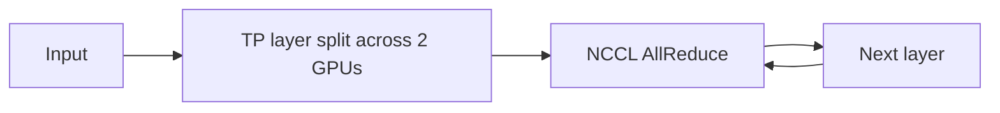

# tensor-parallel-inference

2-GPU **tensor parallel** inference of a 7B LLM, with NCCL communication-overhead
analysis. Shows how matrices are split across devices, how AllReduce synchronizes
partial results, and quantifies the communication cost that dominates small-batch
Decode.

> **Status:** project in progress — results TBD; framework below.

## Background

When a model is too large for one GPU (or Decode is too slow), we shard it across
GPUs. Tensor parallelism splits weight matrices within a layer and uses collective
communication (NCCL AllReduce / AllGather) to exchange activations every layer.
The communication overhead is the key bottleneck to measure.

## Approach



- Run 7B inference with tensor-parallel size 2.
- Instrument with `nvidia-smi`, `nccl-tests`, and nsys to observe communication.
- Compare single-GPU vs. 2-GPU TP: throughput and latency under different batch sizes.
- Analyze AllReduce communication volume (Ring AllReduce formula) vs. actual.

## Results (TBD)

| Batch | Single-GPU (tok/s) | TP=2 (tok/s) | Communication overhead |
|-------|--------------------|--------------|------------------------|
| 1 | — | — | — |
| 8 | — | — | — |
| 32 | — | — | — |

- [ ] nccl-tests bandwidth/latency report
- [ ] nsys timeline showing AllReduce stalls
- [ ] TP matrix-split diagram + per-layer comm volume

## Reproduction

```bash
# e.g. vLLM with --tensor-parallel-size 2, or a custom TP loader
# plus nccl-tests for raw comm numbers
```

## Layout

```
bench/        TP vs. single-GPU comparison scripts
comm/         nccl-tests + nsys analysis
docs/         diagrams, timeline captures
```

## Reference

- Megatron-LM: "Efficient Large-Scale Language Model Training on GPU Clusters"
- NVIDIA NCCL docs
